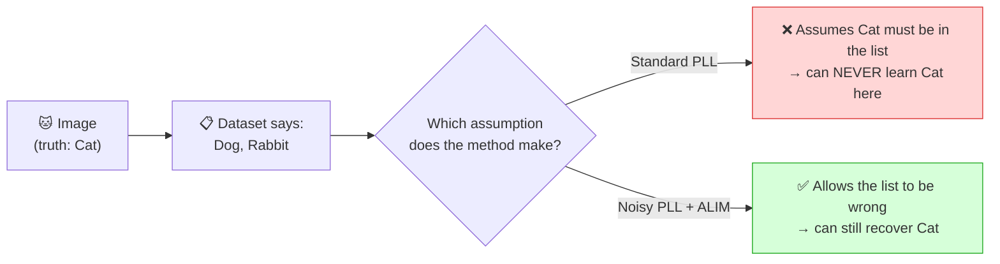
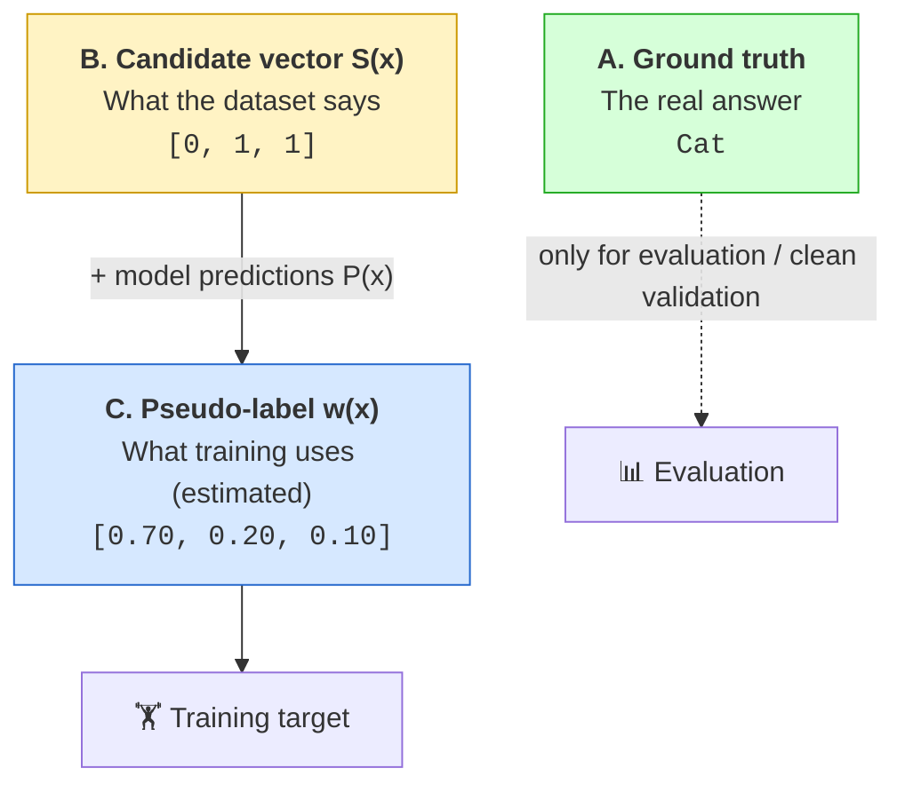
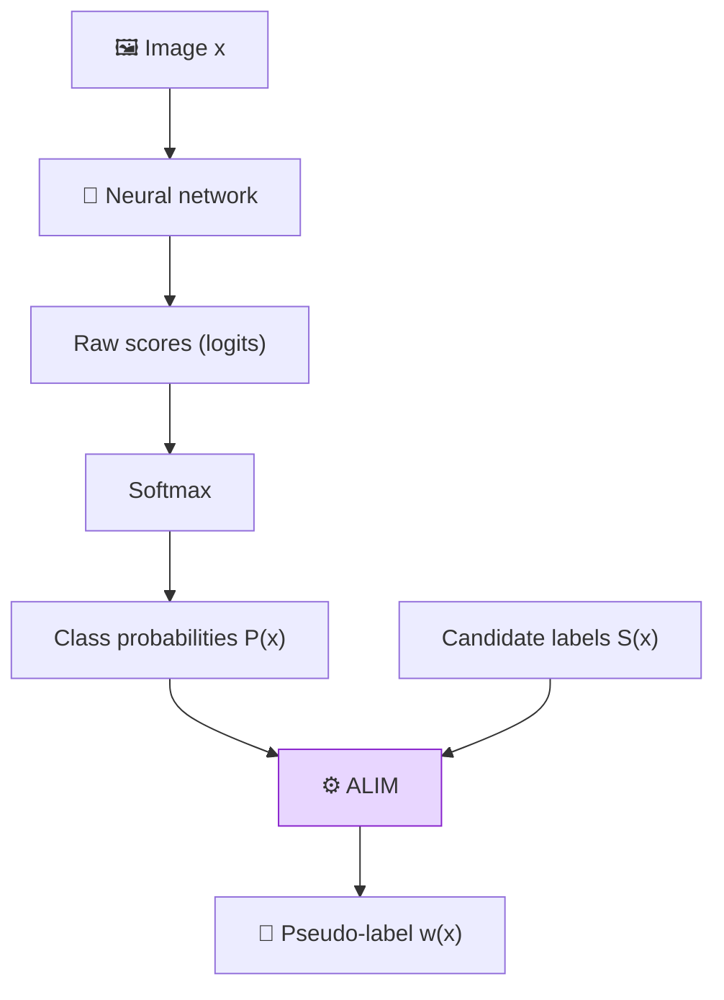
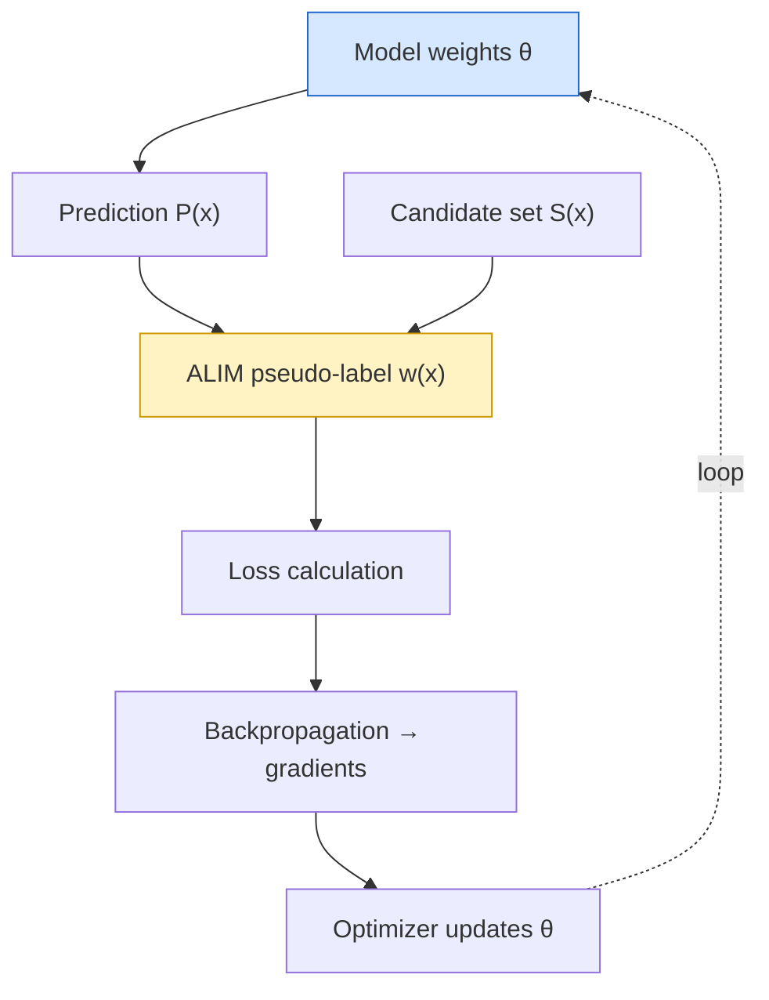
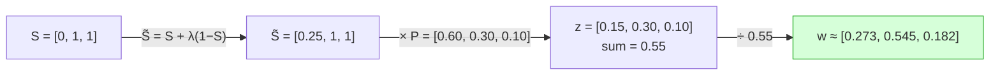
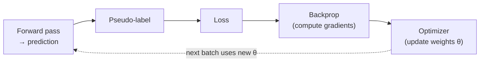
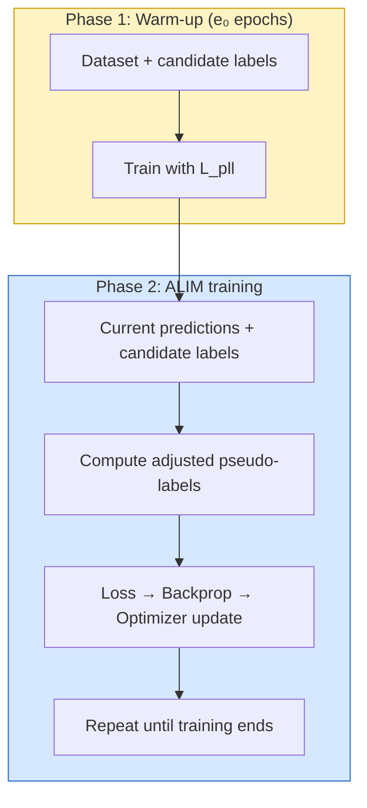
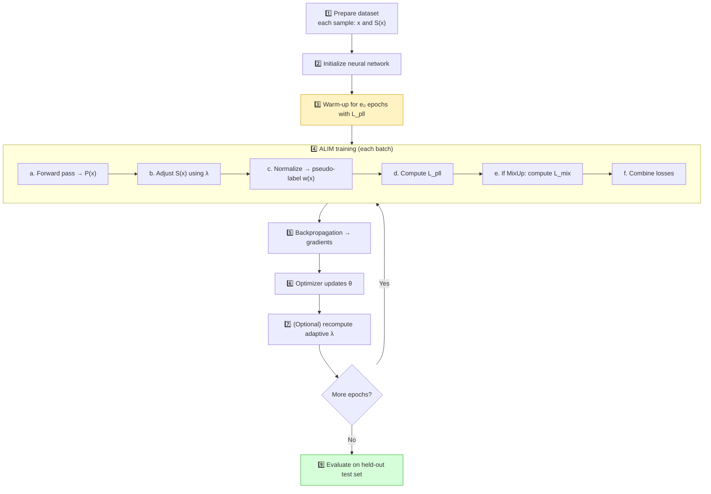

# 🐱 ALIM Project — A Beginner-Friendly Guide

> **ALIM** is a plug-in method for **Noisy Partial-Label Learning (noisy PLL)**.
> This guide explains everything from scratch, with diagrams, tables, and a fully worked numeric example.
> No prior knowledge of deep learning is required.

---

## 📑 Table of Contents

1. [The Problem We Solve](#1--the-problem-we-solve)
2. [Key Terms at a Glance](#2--key-terms-at-a-glance)
3. [Three Kinds of Labels](#3--three-kinds-of-labels--do-not-confuse-them)
4. [What Is a Neural Network Doing?](#4--what-is-a-neural-network-doing)
5. [Model Weights vs. Label Weights](#5--model-weights-vs-label-weights)
6. [ALIM's Central Equations](#6--alims-central-equations)
7. [Worked Example (Step by Step)](#7--worked-alim-example)
8. [Onehot vs. Scale Normalization](#8--onehot-vs-scale-normalization)
9. [What Is Loss?](#9--what-is-loss)
10. [Backpropagation, Gradients, Optimizer](#10--backpropagation-gradients-optimizer)
11. [Batch, Iteration, Epoch](#11--batch-iteration-epoch)
12. [Warm-up Training](#12--warm-up-training)
13. [MixUp](#13--mixup-optional)
14. [Adaptive Lambda](#14--adaptive-lambda-optional)
15. [q and η in the Paper](#15--q-and-η-in-the-paper)
16. [Learning Rate, SGD, Momentum, Weight Decay](#16--learning-rate-sgd-momentum-weight-decay)
17. [Validation vs. Test Set](#17--validation-set-vs-test-set)
18. [Full Training Workflow](#18--full-training-workflow)
19. [Common Misunderstandings](#19--common-misunderstandings)
20. [Quick Self-Test](#20--quick-self-test)

---

## 1. 🎯 The Problem We Solve

Imagine an image really contains a **cat**, but the dataset lists only **Dog** and **Rabbit** as possible labels. The correct class, **Cat**, is **missing** from the candidate set.

| | |
|---|---|
| 🖼️ **Image** | 🐱 |
| ✅ **Actual class (ground truth)** | `Cat` |
| 🏷️ **Candidate labels stored in dataset** | `[Dog, Rabbit]` ← ❌ Cat is missing! The candidate set is **noisy** |
| 🎯 **Goal** | Learn a model that can **still predict Cat correctly** |



| Setting | Assumption about candidate labels |
|---|---|
| **Standard Partial-Label Learning (PLL)** | The true label **is always** among the candidates |
| **Noisy PLL** | The true label **may be missing** |

💡 **ALIM** is a **plug-in method** that *balances* the original candidate set with the model's **own predictions**.

---

## 2. 📖 Key Terms at a Glance

| Term | Beginner-friendly meaning |
|---|---|
| **Dataset** | The collection of training examples |
| **Sample / instance** | One example, such as one image |
| **Class / category** | A possible answer, such as Cat or Dog |
| **Ground-truth label** | The actual correct class, if known |
| **Candidate-label set** | The classes the dataset says *might* be correct |
| **Noisy sample** | A sample whose candidate set may omit the true class or include misleading labels |
| **Model / classifier** | The neural network that predicts classes |
| **Model parameters / weights** | Trainable numbers inside the neural network |
| **Forward pass** | Running an input through the model to get predictions |
| **Logits** | Raw class scores before Softmax |
| **Softmax** | Converts logits into class probabilities |
| **Pseudo-label** | A model-estimated training target; in ALIM it is a vector/distribution over classes |
| **Label importance / pseudo-label weights** | The values assigned to each class in that pseudo-label vector |
| **Loss** | A number measuring how poorly predictions match the training target |
| **Gradient** | A signal showing how parameters should change to reduce loss |
| **Backpropagation** | Calculates gradients from the loss |
| **Optimizer** | Uses gradients to update model parameters |
| **Batch** | A small group of samples processed before an optimizer update |
| **Epoch** | One pass through the full training dataset |
| **Warm-up** | Initial training phase before ALIM's adjusted pseudo-labels are used |
| **Hyperparameter** | A setting chosen for training, such as λ or learning rate |
| **MixUp** | Optional technique that mixes two inputs and their targets |
| **Validation set** | Data used to choose settings or compare model versions |
| **Test set** | Held-out data used to evaluate final performance |

---

## 3. 🏷️ Three Kinds of Labels — Do Not Confuse Them

Class order used throughout this guide: **`[Cat, Dog, Rabbit]`**



### A. Ground-truth label
```text
Ground truth: [Cat]
```
Available for evaluation or a clean validation subset. Noisy-PLL training does **not** assume the true label is in the candidate set.

### B. Candidate-label vector **S(x)**
```text
S(x) = [0, 1, 1]
        C  D  R
```
`1` = in the candidate set, `0` = not. Here the dataset is **wrong**, because Cat is missing.

### C. Pseudo-label vector **w(x)**
```text
w(x) = [0.70, 0.20, 0.10]
          C     D     R
```
Estimated **during training**. Not guaranteed correct. Values sum to 1.

| | Ground truth | Candidate vector `S(x)` | Pseudo-label `w(x)` |
|---|---|---|---|
| **Who provides it?** | Reality | The dataset | The training loop (ALIM) |
| **Example** | `Cat` | `[0, 1, 1]` | `[0.70, 0.20, 0.10]` |
| **Values** | A class name | Only 0 or 1 | Any numbers, sum to 1 |
| **Can be wrong?** | No | ✅ Yes (noisy) | ✅ Yes (estimate) |
| **Changes during training?** | No | No (kept as-is) | ✅ Yes, recalculated |

> 📌 **Remember:** the original dataset is **not overwritten**. Fresh pseudo-labels are computed from current model predictions.

---

## 4. 🧠 What Is a Neural Network Doing?

A classifier takes an image and produces a score for each class.



### Example: Softmax output

| Class | P(x) | Visual |
|---|---|---|
| Cat | 0.60 | 🟦🟦🟦🟦🟦🟦⬜⬜⬜⬜ |
| Dog | 0.30 | 🟦🟦🟦⬜⬜⬜⬜⬜⬜⬜ |
| Rabbit | 0.10 | 🟦⬜⬜⬜⬜⬜⬜⬜⬜⬜ |
| **Total** | **1.00** | |

Softmax outputs are non-negative and sum to 1.

> ⚠️ The paper sections reviewed here explicitly discuss **Softmax**, but do **not** specify a hidden-layer activation like ReLU. Do not claim ALIM mandates ReLU.

---

## 5. ⚖️ Model Weights vs. Label Weights

These are **different things**.

| | **Model weights** (parameters θ) | **Label weights** (pseudo-label values) |
|---|---|---|
| Where they live | Inside the neural network | In one sample's training target |
| What changes them | The **optimizer** | Recalculated from `S(x)` and `P(x)` |
| What they affect | The next prediction | How much each class counts in the loss |



---

## 6. 🧮 ALIM's Central Equations

$$\tilde{S}(x) = S(x) + \lambda\,(1 - S(x))$$

$$w(x) = \operatorname{Normalize}\big(\tilde{S}(x) \odot P(x)\big)$$

| Symbol | Meaning |
|---|---|
| $x$ | One input sample (e.g., an image) |
| $S(x)$ | Original candidate vector (0s and 1s) |
| $P(x)$ | Softmax probabilities from the model |
| $\tilde{S}(x)$ | **Adjusted** candidate-importance vector |
| $\lambda$ | How much to trust classes **outside** the candidate set |
| $\odot$ | Element-by-element multiplication |
| Normalize | Turns values into a valid pseudo-label (usually sums to 1) |
| $w(x)$ | Pseudo-label used as the training target |

### What does λ (lambda) mean?

| λ value | Meaning |
|---|---|
| **λ = 0** | Trust the candidate set **completely**. Outside classes get zero weight. |
| **0 < λ < 1** | Give outside classes **some** weight, still favoring the candidate set. |
| **λ = 1** | No preference for candidates; the pseudo-label **follows the model probabilities**. |

```text
λ = 0  ◄──────────────────────────────────────────►  λ = 1
Trust the dataset                         Trust the model
(candidate set only)                      (own predictions)
```

λ can be chosen **manually** (via validation) or estimated **adaptively** (optional).

---

## 7. 🔢 Worked ALIM Example

Classes: `[Cat, Dog, Rabbit]`

```text
Candidate vector S(x)    = [0, 1, 1]
Model probabilities P(x) = [0.60, 0.30, 0.10]
Lambda                   = 0.25
```



### Step 1 — Adjust the candidate vector

| Class | S | Calculation | S̃ |
|---|---|---|---|
| Cat | 0 | 0 + 0.25 × (1 − 0) | **0.25** |
| Dog | 1 | 1 + 0.25 × (1 − 1) | **1.00** |
| Rabbit | 1 | 1 + 0.25 × (1 − 1) | **1.00** |

### Step 2 — Multiply by model probabilities

| Class | S̃ | P | z = S̃ × P |
|---|---|---|---|
| Cat | 0.25 | 0.60 | **0.15** |
| Dog | 1.00 | 0.30 | **0.30** |
| Rabbit | 1.00 | 0.10 | **0.10** |
| **Sum** | | | **0.55** |

### Step 3 — Normalize (divide by 0.55)

| Class | Adjusted value | Pseudo-label w | Visual |
|---|---|---|---|
| Cat | 0.15 | **0.273** | 🟩🟩🟩⬜⬜⬜⬜⬜⬜⬜ |
| Dog | 0.30 | **0.545** | 🟩🟩🟩🟩🟩🟩⬜⬜⬜⬜ |
| Rabbit | 0.10 | **0.182** | 🟩🟩⬜⬜⬜⬜⬜⬜⬜⬜ |
| **Total** | 0.55 | **1.000** | |

> 🔍 **What to notice:** Cat gets **non-zero weight** even though it was missing from the candidates. But Dog still has the highest weight here. **ALIM does not guarantee** every noisy label gets corrected — it gives the model a *way to consider* classes outside the candidate set.

This example uses plain sum-normalization for easy arithmetic. The paper's two named options are **Onehot** and **Scale** (next section).

### 🎚️ Effect of λ on the same example

| λ | S̃ | z = S̃ ⊙ P | Pseudo-label w (Cat / Dog / Rabbit) | Top class |
|---|---|---|---|---|
| **0** | [0, 1, 1] | [0, 0.30, 0.10] | **0.000 / 0.750 / 0.250** | Dog |
| **0.25** | [0.25, 1, 1] | [0.15, 0.30, 0.10] | **0.273 / 0.545 / 0.182** | Dog |
| **0.5** | [0.5, 1, 1] | [0.30, 0.30, 0.10] | **0.429 / 0.429 / 0.143** | Tie (Cat/Dog) |
| **1** | [1, 1, 1] | [0.60, 0.30, 0.10] | **0.600 / 0.300 / 0.100** | **Cat ✅** |

```text
Cat's pseudo-label weight as λ grows:

λ = 0     ░░░░░░░░░░░░░░░░░░░░  0.00   (Cat impossible)
λ = 0.25  ██████░░░░░░░░░░░░░░  0.27
λ = 0.5   █████████░░░░░░░░░░░  0.43
λ = 1     ████████████░░░░░░░░  0.60   (follows the model)
```

> ⚠️ These are **illustrative teaching numbers**, not experimental results. In practice λ=1 is not always best — an overconfident wrong model would also be trusted fully.

---

## 8. 🔀 Onehot vs. Scale Normalization

| | **Onehot** | **Scale** |
|---|---|---|
| Idea | Pick the single highest-scoring class | Keep a distribution over all classes |
| Uses | The max-valued class → 1, others → 0 | A scaling parameter **K** (temperature-like) |
| Example | `[0.15, 0.30, 0.10]` → `[0, 1, 0]` | `[0.15, 0.30, 0.10]` → e.g. `[0.273, 0.545, 0.182]` |
| Information kept | ❌ Only one class | ✅ All classes |
| Risk | If the top choice is wrong, the hard target is wrong | Softer, more forgiving |

```text
Before:        [0.15, 0.30, 0.10]
Onehot  ──►    [0,    1,    0   ]      (hard choice)
Scale   ──►    [0.27, 0.55, 0.18]      (soft distribution; exact values depend on K)
```

The paper reports that **Scale preserves information for all categories**, while Onehot compresses the target to one class.

> These are **normalization choices** for pseudo-labels — **not** hidden-layer activations.

---

## 9. 📉 What Is Loss?

**Loss** = a number measuring how far the predictions are from the training target.

```text
Prediction P(x): [0.60, 0.30, 0.10]
Target     w(x): [0.27, 0.55, 0.18]
                       │
                       ▼
               Loss function → a single number
```

Lower loss = closer match to the **current training target**. It does **not** prove the target is the true label.

### ALIM's total loss

$$L = L_{pll} + \lambda_{mix}\,L_{mix}$$

| Term | Meaning |
|---|---|
| $L_{pll}$ | Partial-label loss for the sample and its ALIM pseudo-label |
| $L_{mix}$ | Loss for a mixed sample and its mixed pseudo-label (**only if MixUp is on**) |
| $\lambda_{mix}$ | Weight of the MixUp loss (paper default: **1.0**) |

Without MixUp: $L = L_{pll}$.

---

## 10. 🔁 Backpropagation, Gradients, Optimizer

Related, but **not synonyms**:

| Component | Job |
|---|---|
| 📉 **Loss** | Measures the error |
| ◀️ **Backpropagation** | Computes **gradients** (how each parameter affects loss) |
| 🛠️ **Optimizer** | Uses gradients to **update** parameters |



Simplified gradient-descent update:

$$\theta_{new} = \theta_{old} - \text{learning rate} \times \text{gradient}$$

> The paper uses **SGD with momentum**, so the real update also includes momentum. Backpropagation computes gradients; it does **not** directly change the weights.

```text
Epoch 1, Batch 1: prediction → pseudo-label → loss → gradients → update
Epoch 1, Batch 2: uses the updated parameters
Epoch 2, Batch 1: starts with the latest parameters
```

---

## 11. 📦 Batch, Iteration, Epoch

Example: **1,000 images**, **batch size 100**.

| Batch | Images | Action |
|---|---|---|
| 1 | 1–100 | loss → update |
| 2 | 101–200 | loss → update |
| … | … | … |
| 10 | 901–1000 | loss → update |

➡️ After all 10 batches → **1 epoch** complete.

| Term | Meaning |
|---|---|
| **Batch size** | Samples processed together |
| **Iteration / step** | One batch's forward + backward + update cycle |
| **Epoch** | One pass over the whole training set |

---

## 12. 🔥 Warm-up Training

ALIM doesn't use its adjusted pseudo-labels from epoch 1.



**Why warm up?** Early predictions are random-ish. Warm-up lets the model learn basic patterns first so its predictions are worth trusting.

The paper tests warm-up lengths of **20, 40, 80, 100, 140** epochs. The best value depends on the experiment and validation.

---

## 13. 🎨 MixUp (Optional)

MixUp blends two samples **and** their targets.

$$x_{mix} = \alpha x_i + (1-\alpha)x_j \qquad w_{mix} = \alpha\, w(x_i) + (1-\alpha)\, w(x_j)$$

($\alpha$ is sampled from a Beta distribution.)

### Example
```text
Image A: Cat, target [1, 0, 0]
Image B: Dog, target [0, 1, 0]
α = 0.7

Mixed target = 0.7 × [1,0,0] + 0.3 × [0,1,0] = [0.7, 0.3, 0]
```

| Class | Image A | Image B | Mixed (α=0.7) |
|---|---|---|---|
| Cat | 1 | 0 | **0.7** |
| Dog | 0 | 1 | **0.3** |
| Rabbit | 0 | 0 | **0.0** |

Can improve robustness, but **MixUp is optional** in ALIM.

---

## 14. 🤖 Adaptive Lambda (Optional)

| Strategy | How λ is chosen |
|---|---|
| **Manual λ** | Pick from a set of candidate values using validation |
| **Adaptive λ** | Estimate noise level η → compute a score per sample → use the **η-quantile** of the scores |

Per-sample score:

$$r(x) = \frac{\max_i S_i(x)\,P_i(x)}{\max_i (1 - S_i(x))\,P_i(x)}$$

= *best probability among candidates* ÷ *best probability among non-candidates*.

**Example** (`S=[0,1,1]`, `P=[0.60,0.30,0.10]`):

| | Value |
|---|---|
| Best candidate probability | 0.30 (Dog) |
| Best non-candidate probability | 0.60 (Cat) |
| **r(x)** | 0.30 / 0.60 = **0.5** |

A **low** r(x) suggests the model disagrees with the candidate set → the sample may be noisy.

> Adaptive λ is **optional**. A project may use a fixed λ. Don't assume it's enabled unless your code/config confirms it.

---

## 15. 🧪 q and η in the Paper

Dataset-**generation** settings used in the paper's experiments:

| Symbol | Name | Controls |
|---|---|---|
| **q** | Ambiguity level | Chance of adding **incorrect** labels as false-positive candidates |
| **η** | Noise level | Proportion of samples whose **true label is removed** from the candidates and a wrong one added |

❌ They are **not** the learning rate, and **not** ALIM's λ.

---

## 16. ⚙️ Learning Rate, SGD, Momentum, Weight Decay

Settings reported in the paper:

| Setting | Value |
|---|---|
| Optimizer | SGD with momentum **0.9** |
| Weight decay | **0.001** |
| Initial learning rate | **0.01** |
| LR schedule | **Cosine** scheduler |

| Term | Meaning |
|---|---|
| **SGD** | Updates parameters using gradients from batches |
| **Learning rate** | Size of each update (too big → unstable, too small → slow) |
| **Momentum** | Uses past gradients to smooth updates |
| **Weight decay** | Regularization that discourages overly large parameters |
| **Cosine scheduler** | Shrinks learning rate along a cosine-shaped curve |

> Your implementation may use different values.

---

## 17. 🧪 Validation Set vs. Test Set

| Set | Purpose | Used to tune? |
|---|---|---|
| **Training** | Update model parameters | — |
| **Validation** | Choose hyperparameters (λ, warm-up length…) | ✅ Yes |
| **Test** | Final evaluation only | ❌ No |

The paper uses a **clean validation set** to select hyperparameters, then converts it back to partial-label form for training. This is specific to the paper's protocol and may not fit every real-world project.

---

## 18. 🗺️ Full Training Workflow



### What changes vs. what stays fixed

| Item | Changes during training? |
|---|---|
| Original candidate labels `S(x)` | ❌ Usually kept as-is |
| Model parameters θ | ✅ Updated by the optimizer |
| Predictions `P(x)` | ✅ Change as the model improves |
| Pseudo-labels `w(x)` | ✅ Recalculated each time |
| Loss and gradients | ✅ Recalculated each step |

---

## 19. 🚫 Common Misunderstandings

| ❌ Myth | ✅ Reality |
|---|---|
| "Backpropagation updates the weights." | It **computes gradients**; the **optimizer** updates weights. |
| "A pseudo-label is the true label." | It's an **estimate** and may be wrong. |
| "ALIM permanently changes dataset labels." | Not necessarily; pseudo-labels are computed **during training**. |
| "Softmax is the same as ALIM." | Softmax gives probabilities; ALIM **combines** them with candidate labels. |
| "Lambda is the learning rate." | λ = trust in candidates vs. model; learning rate = update size. |
| "Onehot and Scale are hidden-layer activations." | They're **normalization choices** for pseudo-labels. |
| "Lower loss proves the model is correct." | Not with noisy targets. |

---

## 20. 📝 Quick Self-Test

Try answering without scrolling up:

1. What's the difference between `S(x)` and `w(x)`?
2. What does Softmax produce?
3. What does λ control in ALIM?
4. What does loss measure?
5. What does backpropagation calculate?
6. Which component updates model parameters?
7. What is one epoch?
8. Is MixUp mandatory in ALIM?
9. Does the paper specify ReLU as the hidden activation in the sections described?
10. Are model weights and pseudo-label weights the same?

<details>
<summary>👀 Click to reveal answers</summary>

1. `S(x)` is the original candidate vector; `w(x)` is the estimated pseudo-label.
2. A probability distribution over classes.
3. The balance between the candidate set and the model's predictions.
4. How poorly predictions match the training target.
5. Gradients.
6. The optimizer.
7. One pass through the training dataset.
8. No, it's optional.
9. No. Softmax is explicitly described; hidden activations are not specified.
10. No, they're different.

</details>

---

## 📌 Source Note

This guide is based primarily on the paper's problem definition, ALIM framework, optional components, algorithm, and implementation details. The arithmetic examples are **illustrative teaching examples**, **not** reported experimental results. For implementation specifics — exact backbone, hidden activations, whether adaptive λ and MixUp are enabled — check your project's actual **code and configuration**.
