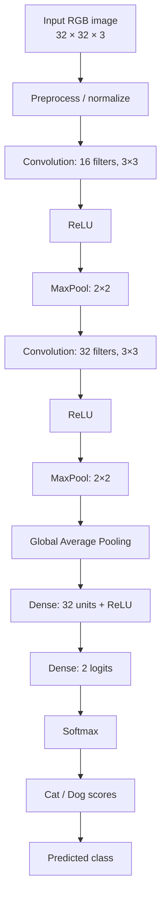
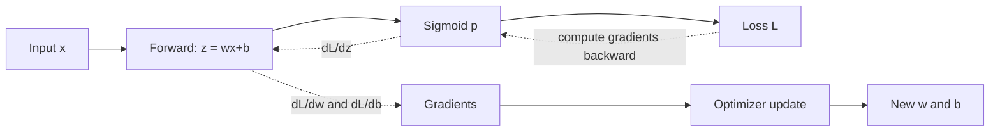
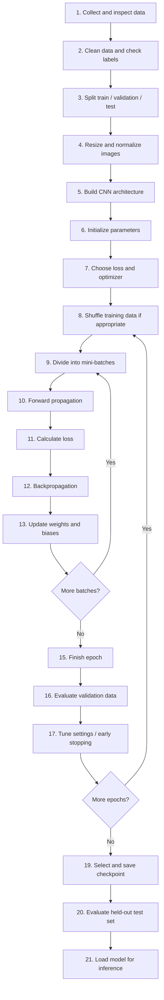
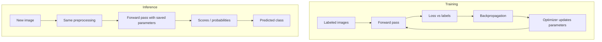
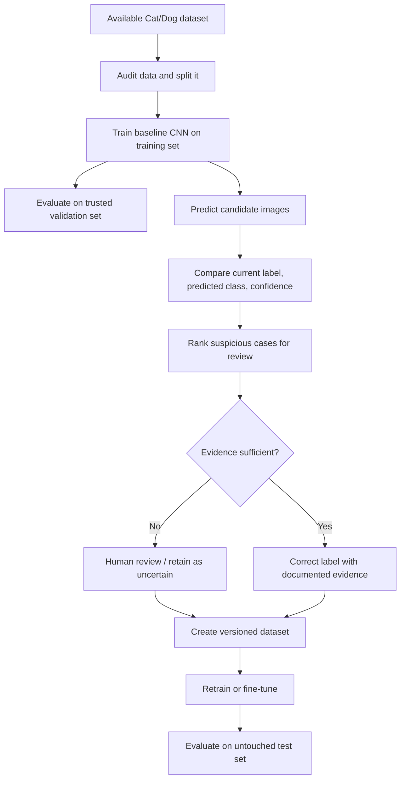

# CNN Complete Guide: From Pixels to Training and Prediction

> **Audience:** Deep-learning beginners  
> **Running example:** Classifying an image as **Cat** or **Dog**  
> **Goal:** Understand what a CNN computes, what it learns, how it trains, and how it can support label-noise detection.

This guide uses small numerical examples and text diagrams so it remains readable offline. Mermaid diagrams render in many Markdown viewers; if your viewer does not support Mermaid, use the accompanying explanations and ASCII diagrams.

---

## Table of Contents

1. [Introduction to CNNs](#1-introduction-to-cnns)
2. [Important CNN Terms](#2-important-cnn-terms)
3. [Follow One Image Through a CNN](#3-follow-one-image-through-a-cnn)
4. [Convolution: Complete Numerical Example](#4-convolution-complete-numerical-example)
5. [Weights, Biases, and Neurons](#5-weights-biases-and-neurons)
6. [Activation Functions](#6-activation-functions)
7. [Hidden Layers, Filters, and Feature Maps](#7-hidden-layers-filters-and-feature-maps)
8. [Forward Propagation](#8-forward-propagation)
9. [Loss Functions](#9-loss-functions)
10. [Backpropagation Step by Step](#10-backpropagation-step-by-step)
11. [Optimizers and Weight Updates](#11-optimizers-and-weight-updates)
12. [Complete CNN Training Lifecycle](#12-complete-cnn-training-lifecycle)
13. [What Happens During Each Epoch?](#13-what-happens-during-each-epoch)
14. [Training Versus Inference](#14-training-versus-inference)
15. [Complete TensorFlow/Keras Example](#15-complete-tensorflowkeras-example)
16. [CNN Shapes and Parameter Counts](#16-cnn-shapes-and-parameter-counts)
17. [Common CNN Problems](#17-common-cnn-problems)
18. [Connection to Label-Noise Detection](#18-connection-to-label-noise-detection)
19. [Common Misconceptions](#19-common-misconceptions)
20. [Revision Sheet and Practice](#20-revision-sheet-and-practice)
21. [Official Learning Resources](#21-official-learning-resources)

---

# 1. Introduction to CNNs

## 1.1 The AI family tree

**Artificial Intelligence (AI)** means building systems that perform tasks associated with intelligence. Think of AI as the broad umbrella. A rule-based assistant is one example.

**Machine Learning (ML)** is a part of AI in which a system learns patterns from examples rather than relying only on hand-written rules. For example, an ML model learns from labeled cat and dog photos.

**Deep Learning (DL)** is a part of ML that uses neural networks with multiple layers to learn representations. A deep network may learn useful image patterns directly from pixels.

A **Convolutional Neural Network (CNN)** is a neural-network design especially suited to grid-like data such as images. Imagine a system that scans small patches of a photo, learns edges and textures, combines them into more complex patterns, and predicts the image class.

```text
Artificial Intelligence (AI)
└── Machine Learning (ML)
    └── Deep Learning (DL)
        └── Convolutional Neural Networks (CNNs)
```

This is a simplified family tree: CNNs are one kind of deep-learning model, not the only kind.

## 1.2 ANN and CNN

An **Artificial Neural Network (ANN)** is inspired loosely by connected biological neurons. In practice, it is a mathematical function made from layers of units, weights, biases, and activation functions.

A **Multilayer Perceptron (MLP)** is a common ANN made mainly of fully connected layers. Every neuron in one layer connects to every neuron in the next layer.

A CNN adds operations such as convolution and pooling that make use of local spatial structure. Analogy: an MLP looks at a long list of pixel values; a CNN first examines nearby groups of pixels and reuses the same learned detector across the image.

| Model | How it works | Typical applications |
|---|---|---|
| Traditional ML | Often learns from designed or selected features | Tabular data, forecasting, fraud detection |
| ANN/MLP | Learns combinations of connected numerical inputs | Tabular data, classification, regression |
| CNN | Learns spatial image features using shared filters | Image classification, object detection, medical imaging |

## 1.3 Why use CNNs for images?

Images have spatial structure: pixels close to each other often form edges, textures, and object parts. A CNN takes advantage of this by:

- **Local connectivity:** a filter examines a small patch at a time.
- **Weight sharing:** the same filter is reused at different positions.
- **Hierarchical features:** layers can combine simple patterns into more complex representations.
- **Parameter efficiency:** a convolution often needs far fewer parameters than a fully connected layer over every pixel.

A fully connected network can process images, but flattening a large image into one long vector can create a huge number of parameters and discards the explicit 2D arrangement. CNNs are not automatically better for every task, but they are a natural baseline for many vision problems.

## 1.4 Real-world uses

- Classifying images (cat versus dog, plant species).
- Detecting objects (finding a pedestrian or vehicle and its location).
- Medical-image analysis, with appropriate clinical validation.
- Quality inspection in manufacturing.
- Satellite and aerial imagery.
- OCR and document-image processing.
- Face and gesture analysis, subject to privacy and fairness requirements.

## 1.5 Pixels, channels, and image tensors

A **pixel** is a small picture element. Analogy: it is one tiny tile in a mosaic. Each pixel stores a numerical intensity or color.

A grayscale image has one channel. An RGB image has three channels: red, green, and blue. A color pixel might be `[200, 80, 30]`, meaning its red, green, and blue intensities are those values on a 0–255 scale.

Example 4 × 4 grayscale image:

```text
  0  20  40  60
 10  30  50  70
 20  40  60  80
 30  50  70  90
```

Its shape is `4 × 4` or `4 × 4 × 1` when the channel dimension is written explicitly.

A 4 × 4 RGB image has shape `4 × 4 × 3`. Each location has three numbers:

```text
Pixel at row 1, column 1: [R, G, B] = [200, 80, 30]
Image shape: height × width × channels = 4 × 4 × 3
```

In TensorFlow/Keras, a batch commonly has shape `(batch, height, width, channels)`, such as `(32, 32, 32, 3)`. PyTorch commonly uses `(batch, channels, height, width)`, such as `(32, 3, 32, 32)`.

**Normalization** rescales pixel values to a more convenient range. A common choice is `pixel / 255.0`, turning 0–255 into 0–1. Analogy: converting measurements into a consistent scale. Use the same preprocessing during training and inference.

---

# 2. Important CNN Terms

Each term starts with a plain-language meaning, an analogy, and an example.

| Term | Simple definition | Analogy | Example | Where it is used |
|---|---|---|---|---|
| Dataset | Collection of examples | A photo album | Cat and dog photos | Training/evaluation |
| Training data | Examples used to learn parameters | Practice questions with answers | 800 labeled photos | Optimization |
| Validation data | Separate examples used to choose settings/check progress | A practice exam | 100 photos | Model selection |
| Test data | Held-out examples for final evaluation | A final exam | 100 untouched photos | Final reporting |
| Input tensor | Multi-dimensional array given to a model | A stack of organized number grids | `32×32×3` image | Model input |
| Channel | One component of image data | One layer of a transparent stack | R, G, or B | Image representation |
| Kernel/filter | Small array of learnable numbers applied across an image | A reusable pattern detector | `3×3×3` filter | Convolution |
| Convolution | Sliding a filter across an input and computing weighted sums | Scanning a page with a small stencil | Each patch yields one number | Feature extraction |
| Feature map | Output grid showing a filter's response at locations | A heat map of where a detector responds | `30×30` map | CNN intermediate output |
| Stride | Number of pixels the filter moves each step | Steps taken while scanning | Stride 2 skips positions | Convolution/pooling |
| Padding | Extra border values, often zeros | A margin around a picture | `same` padding | Shape control |
| Activation function | Nonlinear function applied to a layer's values | A rule that transforms a signal | ReLU clips negatives | Neural layers |
| ReLU | `max(0,x)` | A gate that passes positive values | ReLU(-3)=0 | Hidden layers |
| Sigmoid | Maps a real number to 0–1 | A smooth dial between 0 and 1 | Sigmoid(0)=0.5 | Binary output, gates |
| Softmax | Converts class logits into scores summing to 1 | Dividing a fixed probability budget among classes | Cat 0.73, Dog 0.27 | Multiclass output |
| Neuron/unit | Computes a weighted sum, bias, and usually activation | A small calculator | `a=f(w·x+b)` | Neural network |
| Weight | Learned multiplier controlling an input's contribution | A volume knob for a signal | `0.5×x` | Trainable parameters |
| Bias | Learned offset added to a weighted sum | A starting-point adjustment | `z=w·x+b` | Trainable parameters |
| Trainable parameters | Weights and biases the optimizer can update | Adjustable knobs | Filter values and dense weights | Training |
| Hidden layer | Layer between input and output | An intermediate stage in a pipeline | Convolution block | Representation learning |
| Convolutional layer | Applies learned filters to local input patches | Repeated stencil scanning | 8 filters of size 3×3 | Feature extraction |
| Pooling layer | Summarizes nearby values, usually reducing spatial size | Summarizing a neighborhood | 2×2 max pooling | Downsampling |
| Max pooling | Keeps the largest value in a region | Keep the strongest signal | max(1,4,2,3)=4 | Downsampling |
| Average pooling | Keeps the mean of a region | Take the neighborhood average | mean(1,2,3,4)=2.5 | Downsampling |
| Flatten | Reshapes a tensor into one vector | Unrolling a grid into a list | `2×2×3 → 12` values | Dense classifier input |
| Dense layer | Every output unit connects to every input feature | Each worker receives every item | 100 inputs to 10 units | Classification head |
| Logits | Raw class scores before Softmax/sigmoid | Unnormalized votes | Cat 2.0, Dog 1.0 | Output layer |
| Probability/score | A normalized model output, depending on activation | A share of the total | Softmax score 0.73 | Interpretation |
| Ground-truth label | Label supplied as the target | The answer written on the answer key | `Cat` | Supervised learning |
| Prediction | Model's output for an example | The model's answer | `Dog` | Inference |
| Loss function | Measures mismatch between prediction and target | A penalty score | Cross-entropy | Training objective |
| Gradient | Derivative indicating how a value changes with a parameter | A slope arrow | `dL/dw` | Backpropagation |
| Gradient descent | Updates parameters opposite the loss gradient | Walk downhill to reduce a score | `w←w−η∇L` | Optimization |
| Backpropagation | Computes gradients by applying the chain rule backward | Trace blame backward through a process | Find `dL/dw` | Training |
| Learning rate | Step-size setting for parameter updates | Length of each downhill step | `η=0.001` | Hyperparameter |
| Optimizer | Rule/algorithm that uses gradients to update parameters | The method for taking steps | SGD, Adam | Training |
| Batch | Group of examples processed together | A small stack of homework pages | 100 images | Training loop |
| Batch size | Number of examples in one batch | Stack size | 100 | Hyperparameter |
| Epoch | One pass through the training set | One complete study round | 1,000 images seen once | Training loop |
| Iteration/step | One batch-processing/update step in a typical training loop | One work cycle | 10 batches per epoch | Training loop |
| Forward propagation | Compute outputs using current parameters | Move from input toward answer | Pixels → logits | Training and inference |
| Regularization | Techniques that discourage overly complex fitting | Rules that discourage over-specializing | Weight decay | Generalization |
| Dropout | Randomly disables some units during training | Practice with some team members temporarily absent | Dropout rate 0.3 | Regularization |
| Overfitting | Fits training examples but performs poorly on new data | Memorizing practice answers | High train, low validation score | Diagnosis |
| Underfitting | Model has not learned enough useful structure | Not learning the material | Low train and validation score | Diagnosis |
| Generalization | Performance on unseen examples | Applying knowledge to new questions | Good test performance | Evaluation |
| Inference | Using a trained model to make predictions | Taking the exam after practice | Predict Cat/Dog | Deployment |
| Checkpoint | Saved model state at a point in training | A bookmark in a long task | Best validation-loss weights | Recovery/model selection |
| Model weights | Learned numerical parameters | The tuned knobs in the model | Saved tensor arrays | Inference |
| Transfer learning | Reusing a model trained on another dataset/task | Building on prior training | Fine-tune an image backbone | Small datasets |
| Pseudo-label | Model-generated label used as a tentative target | A suggested answer awaiting trust | Model suggests Dog | Semi-supervised learning |
| Label noise | Incorrect or unreliable dataset labels | A wrong answer printed in the key | Dog photo labeled Cat | Data quality |
| Confidence score | A measure of how strongly the model favors an output | Strength of a vote | Cat score 0.92 | Review prioritization |

## 2.1 Commonly confused terms

- **Weight vs activation:** A weight is a learned parameter; an activation is a value produced during a forward pass.
- **Filter vs feature map:** A filter is the small set of parameters; a feature map is the grid of responses produced by applying it.
- **Activation function vs loss function:** An activation transforms layer outputs; a loss compares predictions with targets.
- **Epoch vs iteration:** An epoch covers the training set once; an iteration usually processes one batch and performs one update.
- **Backpropagation vs optimizer:** Backpropagation computes gradients; the optimizer uses them to update parameters.
- **Prediction vs ground truth:** A prediction is the model's output; ground truth is the supplied target, which can itself be wrong.
- **Hidden layer vs frozen layer:** “Hidden” describes its position. “Frozen” means its parameters are not updated.
- **Training vs inference:** Training usually computes loss, gradients, and updates; inference normally only computes outputs.

---

# 3. Follow One Image Through a CNN

Consider a `32 × 32 × 3` RGB photo. The CNN first reads its pixels, then builds progressively more useful representations.

## 3.1 Architecture diagram



This is one example architecture, not a universal design.

## 3.2 Shape-tracking table

Assume `padding="same"` for each convolution, stride 1, and 2×2 max pooling with stride 2.

| Stage | Output shape (H × W × C) | Trainable parameters? | Purpose |
|---|---:|---|---|
| Input | 32×32×3 | No | Pixel values |
| Normalize | 32×32×3 | No | Scale values |
| Conv2D, 16 filters, 3×3, same | 32×32×16 | Yes | Learn local patterns |
| ReLU | 32×32×16 | No | Add nonlinearity |
| MaxPool 2×2, stride 2 | 16×16×16 | No | Reduce spatial size |
| Conv2D, 32 filters, 3×3, same | 16×16×32 | Yes | Learn richer patterns |
| ReLU | 16×16×32 | No | Add nonlinearity |
| MaxPool 2×2, stride 2 | 8×8×32 | No | Reduce spatial size |
| Global Average Pooling | 32 | No | Average each channel's spatial map |
| Dense, 32 units | 32 | Yes | Combine features |
| Dense, 2 logits | 2 | Yes | Produce class scores |
| Softmax | 2 | No | Convert logits to normalized scores |

The `same` convolution keeps height and width when stride is 1 by adding padding as needed. Pooling halves them here.

## 3.3 What the image becomes

1. **Input:** numeric pixels.
2. **First convolution:** responses to local patterns such as edges or color transitions.
3. **ReLU:** negative responses become zero; positive responses pass through.
4. **Pooling:** summarizes small neighborhoods and reduces the spatial grid.
5. **Later convolution:** combines earlier responses into more complex patterns.
6. **Global average pooling:** turns each feature map into one summary number.
7. **Dense layer:** combines summaries to support the classification.
8. **Output logits and Softmax:** generate Cat and Dog scores.
9. **Prediction:** choose the class with the largest score.

CNNs often learn simple-to-complex representations because later layers combine earlier features. This is a tendency, not a guarantee that a particular filter means “ear” or “eye.”

---

# 4. Convolution: Complete Numerical Example

A **convolution operation in common deep-learning libraries** usually means cross-correlation: the filter is applied as written rather than rotated 180 degrees. This convention is standard in most CNN implementations and does not prevent the filter from learning useful patterns.

Input image:

```text
1  2  0  1
3  1  2  2
0  1  3  1
2  2  1  0
```

Filter:

```text
 1  0
 0 -1
```

Stride = 1, padding = 0. Output size per dimension:

\[
\left\lfloor\frac{4+2(0)-2}{1}\right\rfloor+1=3
\]

So the output is `3 × 3`.

## 4.1 Calculate every position

For each 2×2 patch, multiply matching positions and add the products.

### Position (row 1, column 1)

Patch:
```text
1  2
3  1
```

Calculation: `1×1 + 2×0 + 3×0 + 1×(-1) = 1 + 0 + 0 - 1 = 0`

Output = **0**

### Position (row 1, column 2)

Patch:
```text
2  0
1  2
```

Calculation: `2×1 + 0×0 + 1×0 + 2×(-1) = 2 + 0 + 0 - 2 = 0`

Output = **0**

### Position (row 1, column 3)

Patch:
```text
0  1
2  2
```

Calculation: `0×1 + 1×0 + 2×0 + 2×(-1) = 0 + 0 + 0 - 2 = -2`

Output = **-2**

### Position (row 2, column 1)

Patch:
```text
3  1
0  1
```

Calculation: `3×1 + 1×0 + 0×0 + 1×(-1) = 3 + 0 + 0 - 1 = 2`

Output = **2**

### Position (row 2, column 2)

Patch:
```text
1  2
1  3
```

Calculation: `1×1 + 2×0 + 1×0 + 3×(-1) = 1 + 0 + 0 - 3 = -2`

Output = **-2**

### Position (row 2, column 3)

Patch:
```text
2  2
3  1
```

Calculation: `2×1 + 2×0 + 3×0 + 1×(-1) = 2 + 0 + 0 - 1 = 1`

Output = **1**

### Position (row 3, column 1)

Patch:
```text
0  1
2  2
```

Calculation: `0×1 + 1×0 + 2×0 + 2×(-1) = 0 + 0 + 0 - 2 = -2`

Output = **-2**

### Position (row 3, column 2)

Patch:
```text
1  3
2  1
```

Calculation: `1×1 + 3×0 + 2×0 + 1×(-1) = 1 + 0 + 0 - 1 = 0`

Output = **0**

### Position (row 3, column 3)

Patch:
```text
3  1
1  0
```

Calculation: `3×1 + 1×0 + 1×0 + 0×(-1) = 3`

Output = **3**

## 4.2 Complete feature map

```text
 0   0  -2
 2  -2   1
-2   0   3
```

The filter has four values and is reused at every location. With stride 1, its top-left corner moves one pixel at a time. With stride 2, it moves two pixels each step, producing a smaller output. **Padding** adds a border (often zeros) so edge locations can also be processed and output dimensions can be controlled.

A multi-channel RGB convolution filter has depth equal to the number of input channels. A filter for RGB is `kernel_height × kernel_width × 3`. Each filter produces one output channel; 16 filters produce 16 feature maps.

Filters begin with initialized values and are learned through gradients during training. The model is not told “this filter must detect a cat ear”; training adjusts values to reduce the chosen loss.

---

# 5. Weights, Biases, and Neurons

A neuron combines inputs into a weighted sum and transforms it:

\[
z=w_1x_1+w_2x_2+b,\qquad a=f(z)
\]

- `x₁, x₂`: input values.
- `w₁, w₂`: learned weights.
- `b`: learned bias.
- `z`: weighted sum before activation.
- `f`: activation function.
- `a`: output activation.

```text
x1 ──× w1 ──┐
             ├── sum + bias b ── z ── activation f ── a
x2 ──× w2 ──┘
```

Example: `x₁=2`, `x₂=3`, `w₁=0.5`, `w₂=-0.2`, `b=0.1`.

\[
z=(0.5)(2)+(-0.2)(3)+0.1=1.0-0.6+0.1=0.5
\]

ReLU gives:

\[
a=\max(0,0.5)=0.5
\]

A **weight** controls how strongly an input contributes, including its sign. A **bias** shifts the weighted sum. Pixels are input data; weights are model parameters. They are different things.

Weights are initialized before learning, commonly with carefully chosen random values. If all weights in a layer were initialized identically, units could learn identical patterns; suitable initialization helps break symmetry and stabilize training. During training, the optimizer updates trainable weights and biases using gradients. If parameters never update, the model generally cannot learn from its training data.

Convolution weights are shared across spatial positions, so the same pattern detector can respond wherever that pattern appears. A high-magnitude weight alone does not prove that a feature is globally important: meaning depends on the network, other parameters, data, and input distribution.

| Concept | Meaning | Example |
|---|---|---|
| Hyperparameter | Chosen by the practitioner, not normally learned by gradient descent | Learning rate, batch size, filter count |
| Trainable parameter | Learned from data | Kernel values, dense weights, biases |
| Initial parameter | Value before training updates | Initial filter values |
| Learned parameter | Value after optimization | Updated filter values |
| Frozen parameter | Kept fixed during a training phase | Frozen pretrained backbone |
| Trainable parameter | Allowed to change | Fine-tuned classifier head |

---

# 6. Activation Functions

An activation function transforms a neuron's weighted sum. Analogy: it is a rule applied to a signal. Without nonlinear activations, a stack of linear layers is still equivalent to one linear transformation, so depth alone would not provide the expressive power of a nonlinear network.

## 6.1 ReLU

Formula: \(f(x)=\max(0,x)\)

- Range: `[0, ∞)`.
- Example: ReLU(-3)=0, ReLU(0)=0, ReLU(4)=4.
- Common use: hidden CNN layers.
- Advantage: simple and efficient.
- Limitation: a unit can become inactive for inputs that always produce negative values.

```text
y
4 |       /
3 |      /
2 |     /
1 |    /
0 +---+-------- x
     0
```

## 6.2 Sigmoid

Formula: \(\sigma(x)=1/(1+e^{-x})\)

Example: `σ(0)=1/(1+1)=0.5`. For `x=2`, `σ(2)≈0.881`. Range: `(0,1)`. It is often used for one binary output with binary cross-entropy. It can saturate for very large positive or negative inputs, leading to small gradients.

```text
y
1 |       _____
  |    __/
.5|---/
  |__/
0 +-------------- x
```

## 6.3 Tanh

Formula: \(\tanh(x)=(e^x-e^{-x})/(e^x+e^{-x})\)

Example: `tanh(0)=0`; `tanh(1)≈0.762`. Range: `(-1,1)`. It is zero-centered, but can saturate at extreme inputs.

## 6.4 Softmax

For logits \(z_i\):

\[
\operatorname{softmax}(z_i)=\frac{e^{z_i}}{\sum_j e^{z_j}}
\]

Example logits: Cat = 2, Dog = 1.

\[
e^2\approx7.389,\qquad e^1\approx2.718
\]
\[
\text{sum}=7.389+2.718=10.107
\]
\[
P(\text{Cat})=7.389/10.107\approx0.731
\]
\[
P(\text{Dog})=2.718/10.107\approx0.269
\]

The scores sum to approximately 1 (small rounding differences are normal). Softmax is typically used for mutually exclusive multiclass classification. Its scores are not guaranteed to be perfectly calibrated probabilities of real-world correctness.

## 6.5 Linear activation

Formula: `f(x)=x`. Example: `f(2.5)=2.5`. Range: all real numbers. Often used in regression outputs; hidden layers made only of linear activations do not gain nonlinear expressive power.

| Function | Formula | Output range | Typical use |
|---|---|---|---|
| ReLU | `max(0,x)` | `[0,∞)` | Hidden layers |
| Sigmoid | `1/(1+e^-x)` | `(0,1)` | Binary output |
| Tanh | Hyperbolic tangent | `(-1,1)` | Some hidden/gating settings |
| Softmax | `exp(logit)/sum(exp(logits))` | Each score `(0,1)`; sum 1 | Multiclass output |
| Linear | `x` | Real numbers | Regression output |

**Hidden activations** are intermediate values used by later layers. **Output probabilities** are final transformed class scores. They serve different purposes.

---

# 7. Hidden Layers, Filters, and Feature Maps

A **hidden layer** is an intermediate layer between input and output. It is called hidden because its values are not usually the final user-facing prediction. It does not mean the weights are frozen.

A **feature map** is a grid of responses produced when a filter is applied. Strong values can indicate that the filter responds to a pattern at those locations. A filter is the detector; the feature map is its response over the image.

Illustrative hierarchy—not a promise about what every individual filter represents:

| Layer | Example learned representation | Purpose |
|---|---|---|
| Early convolution | Edges and simple textures | Basic visual patterns |
| Intermediate convolution | Texture combinations and object parts | More complex patterns |
| Deeper convolution | Higher-level class-relevant patterns | Useful representations |
| Dense/output layers | Class scores | Final classification |

Deep features are not guaranteed to correspond to human-interpretable objects. Some respond to combinations of textures, colors, shapes, or less obvious statistical patterns.

## 7.1 Max pooling example

Input:

```text
1  3
2  4
```

A 2×2 max-pooling window returns `max(1,3,2,4)=4`, so the output is:

```text
4
```

Pooling layers usually have no trainable weights. They summarize or downsample values.

## 7.2 Flatten versus Global Average Pooling

Suppose a tensor has shape `2 × 2 × 3`. It contains `2×2×3=12` numbers. Flatten turns it into a length-12 vector, preserving every value but losing the explicit grid shape.

Global Average Pooling averages each channel's entire spatial map. For a `2×2×3` tensor, it returns 3 numbers—one mean per channel. It typically creates a smaller classifier input than Flatten and can reduce parameter count.

---

# 8. Forward Propagation

**Forward propagation** means computing a prediction using the current parameters. Analogy: follow a recipe from ingredients to finished result. No parameter update happens automatically just because a forward pass was computed.

Consider a tiny network with two input values, one ReLU hidden unit, and two output logits.

Inputs: `x₁=1`, `x₂=2`.

Hidden unit:
- weights `w₁=0.5`, `w₂=0.25`, bias `b=0`
- weighted sum `z₁=0.5(1)+0.25(2)+0=1`
- ReLU activation `a₁=max(0,1)=1`

Output logits:
- Cat: `z_cat=1.2a₁+0.1=1.3`
- Dog: `z_dog=0.7a₁+0.2=0.9`

Softmax:
- `exp(1.3)≈3.669`, `exp(0.9)≈2.460`
- total ≈ `6.129`
- Cat ≈ `3.669/6.129 = 0.599`
- Dog ≈ `2.460/6.129 = 0.401`

Prediction: **Cat**, because its score is higher.

```text
Input values
    ↓
Weighted sum (weights + bias)
    ↓
Activation
    ↓
Next layer
    ↓
Logits → Softmax → class scores → predicted class
```

CNNs use the same overall principle. Convolution and pooling process spatial features before the classification layers.

---

# 9. Loss Functions

A **loss** is a numerical measure of how much a model's prediction disagrees with its target. Analogy: a penalty score on a practice answer. During supervised training, the model uses the supplied target; if that label is wrong, the loss may encourage the model toward the wrong answer.

Example: actual label = Cat, predicted Cat score = 0.8, Dog score = 0.2.

For categorical cross-entropy with one correct class:

\[
L=-\ln(p_{\text{correct}})=-\ln(0.8)\approx0.2231
\]

If the correct class score were `0.1`, loss would be `-ln(0.1)≈2.3026`, much larger. A confident incorrect prediction is usually penalized strongly.

- **Loss:** how wrong predictions are according to the chosen objective.
- **Accuracy:** fraction of predictions whose selected class matches the target.
- A model can have good accuracy but poor probability quality, or vice versa.
- **Binary cross-entropy:** common for a single sigmoid output representing two classes.
- **Categorical cross-entropy:** common for one-hot targets and Softmax multiclass outputs.
- **Sparse categorical cross-entropy:** common when multiclass labels are integer class IDs.

Training usually aims to minimize an average loss over training batches. Loss measures disagreement with the supplied training target—not necessarily with the true world if labels are noisy.

---

# 10. Backpropagation Step by Step

**Backpropagation** calculates gradients of the loss with respect to model parameters using the chain rule. Analogy: trace how a final error depends on each earlier calculation. It calculates what direction would locally increase or decrease loss; it does **not** itself update the parameters.

We use:
- input `x=1`
- initial weight `w=0.5`
- bias `b=0`
- target `y=1`
- learning rate `η=0.1`
- sigmoid activation
- binary cross-entropy loss

## 10.1 Forward pass

Logit:

\[
z=wx+b=(0.5)(1)+0=0.5
\]

Sigmoid output:

\[
p=\sigma(0.5)=\frac{1}{1+e^{-0.5}}\approx0.622459
\]

Binary cross-entropy for target 1:

\[
L=-\ln(p)\approx-\ln(0.622459)\approx0.474077
\]

## 10.2 Gradients

For sigmoid combined with binary cross-entropy, the derivative of loss with respect to the logit simplifies to:

\[
\frac{\partial L}{\partial z}=p-y=0.622459-1=-0.377541
\]

Since `z=wx+b`:

\[
\frac{\partial z}{\partial w}=x=1,\qquad
\frac{\partial z}{\partial b}=1
\]

By the chain rule:

\[
\frac{\partial L}{\partial w}
=\frac{\partial L}{\partial z}\frac{\partial z}{\partial w}
=(-0.377541)(1)=-0.377541
\]

\[
\frac{\partial L}{\partial b}
=\frac{\partial L}{\partial z}\frac{\partial z}{\partial b}
=-0.377541
\]

## 10.3 Optimizer update

\[
w_{\text{new}}=w_{\text{old}}-\eta\frac{\partial L}{\partial w}
\]
\[
w_{\text{new}}=0.5-0.1(-0.377541)=0.537754
\]

\[
b_{\text{new}}=0-0.1(-0.377541)=0.037754
\]

The negative gradients mean increasing these parameters locally reduces loss for this example.

## 10.4 New prediction and loss

\[
z_{\text{new}}=(0.537754)(1)+0.037754\approx0.575508
\]
\[
p_{\text{new}}=\sigma(0.575508)\approx0.6400
\]
\[
L_{\text{new}}=-\ln(0.6400)\approx0.446
\]

The loss decreased in this example. That is not guaranteed for every update in a large network, especially with mini-batches, momentum, or a large learning rate.



**The four separate actions:**

1. Forward propagation computes the prediction.
2. Loss calculation compares prediction with target.
3. Backpropagation computes gradients.
4. The optimizer uses gradients to update trainable parameters.

In a CNN, convolution filters receive gradients too. Each filter is reused at many positions, so its gradient combines contributions from the positions where it was applied.

---

# 11. Optimizers and Weight Updates

The basic gradient-descent update is:

\[
w_{\text{new}}=w_{\text{old}}-\eta\times\text{gradient}
\]

Example: `w_old=0.5`, gradient `0.2`, learning rate `0.1`.

\[
w_{\text{new}}=0.5-(0.1)(0.2)=0.48
\]

The minus sign moves opposite the gradient, which locally points toward increasing loss.

- **Gradient Descent:** uses a gradient over the dataset (or a large batch).
- **Stochastic Gradient Descent (SGD):** updates using one example at a time in its classic form.
- **Mini-batch Gradient Descent:** uses a small group of examples; common in deep learning.
- **Momentum:** accumulates a moving direction from previous gradients to smooth updates.
- **Adam:** adapts step sizes using moving estimates of gradient means and squared gradients; often a strong starting choice.
- **Learning rate:** controls step size.

If the learning rate is too high, training can oscillate or diverge. If too low, learning may be slow or stall. A single example can give a noisy gradient because it may not represent the whole dataset. Optimizers update trainable model parameters, not the ordinary input pixels. Data augmentation can transform training images, but that is a separate data pipeline.

---

# 12. Complete CNN Training Lifecycle



## 12.1 What each phase means

1. **Collect and inspect:** check image quality, class counts, duplicates, permissions, and label reliability.
2. **Clean labels:** inspect obvious mistakes and document any corrections.
3. **Split:** reserve separate training, validation, and test sets. Avoid near-duplicate or same-subject leakage across splits where relevant.
4. **Preprocess:** resize to the model's expected size and normalize consistently.
5. **Build:** choose layer types and sizes.
6. **Initialize:** assign starting values to trainable parameters.
7. **Choose objective and optimizer:** for example, sparse categorical cross-entropy and Adam.
8. **Shuffle:** often useful to reduce ordering effects.
9. **Batch:** process manageable groups of examples.
10. **Forward:** calculate predictions.
11. **Loss:** compare predictions with targets.
12. **Backpropagate:** compute gradients.
13. **Update:** apply optimizer steps.
14. **Repeat batches:** continue until all training examples have been processed for the epoch.
15. **Finish epoch:** one pass through the training set is complete.
16. **Validate:** estimate performance on data not used to calculate that epoch's gradients.
17. **Tune:** adjust hyperparameters based on validation performance; early stopping may halt training.
18. **Repeat epochs:** continue from the current learned parameters, not from scratch.
19. **Checkpoint:** save a chosen model state, often the best validation checkpoint.
20. **Test:** evaluate the selected model on the held-out test set.
21. **Inference:** load the saved model and predict new images.

For 1,000 training images and batch size 100:

- Batches per epoch = `1000 / 100 = 10`.
- For 10 epochs: `10 × 10 = 100` batch updates, assuming every batch produces one update and no special accumulation is used.

Training does **not** normally replace the dataset with predictions after each epoch. Parameters, predictions, labels, and pseudo-labels are different things. Dataset labels change only if a separate label-cleaning or pseudo-labeling process explicitly changes them.

| Stage | Uses training labels? | Updates model weights? | Main purpose |
|---|---|---|---|
| Training | Yes | Yes | Learn parameters |
| Validation | Usually labels are used to calculate metrics; no gradient updates | No | Select and tune the model |
| Testing | Labels used for evaluation | No | Estimate generalization |
| Inference | No ground-truth labels required | No | Predict new samples |

---

# 13. What Happens During Each Epoch?

An **epoch** is one pass through all training examples. A **batch** is a group of examples processed together. An **iteration** usually means one batch step/update.

Analogy: the dataset is a textbook, an epoch is one complete reading, a batch is one chapter-sized study session, and an iteration is one session's work.

With 1,000 images, batch size 100, and 10 epochs:

| Epoch | Batches processed | What happens |
|---|---:|---|
| 1 | 10 | Model learns from training batches |
| 2 | 10 | Continues from updated parameters |
| 3 | 10 | Continues learning |
| … | … | … |
| 10 | 10 | Completes the planned epochs |

- The model normally **does not start from scratch** each epoch; it retains its current parameters.
- Parameters are commonly updated after each batch.
- Activations and gradients are recalculated for each batch.
- Loss is calculated many times—typically once per batch and aggregated for reporting.
- The dataset is not automatically relabeled.
- Individual batch loss can rise even while overall training improves.
- Training loss and validation loss differ because they use different examples; training may also use augmentation, dropout, or other training-only behavior.

Illustrative values only—not experimental results:

| Epoch | Training loss | Validation loss |
|---:|---:|---:|
| 1 | 0.95 | 1.00 |
| 2 | 0.72 | 0.82 |
| 3 | 0.56 | 0.70 |
| 4 | 0.43 | 0.66 |
| 5 | 0.34 | 0.69 |
| 6 | 0.28 | 0.75 |

```text
Illustrative loss trend (lower is better)
Loss
1.0 | T/V
0.8 |   T V
0.6 |      T  V
0.4 |         T
0.2 |            T
    +----------------
      1  2  3  4  5  6  Epoch

T = training loss tends to fall
V = validation loss falls, then rises in this illustration
```

The rising validation loss while training loss keeps falling can be a sign of overfitting. The numbers above are illustrative and should not be treated as a benchmark.

---

# 14. Training Versus Inference

Training uses labeled examples to improve model parameters. Inference uses saved parameters to produce an output for a new example.



Suppose the trained model outputs:

- Cat = `0.15`
- Dog = `0.85`

The selected class is **Dog**, because `0.85` is the higher score. That is the model's prediction, not a guarantee.

During ordinary inference:
- weights are not updated;
- ground-truth labels and loss are not needed just to return a prediction;
- preprocessing must match training (size, channel order, normalization);
- a changed image distribution can hurt performance;
- a high confidence score can still be wrong.

---

# 15. Complete TensorFlow/Keras Example

This runnable example uses CIFAR-10, a public dataset of 32×32 color images in 10 classes. It demonstrates a full training/evaluation/save/reload/predict workflow. It does **not** claim any specific accuracy; results depend on software versions, random initialization, hardware, and training settings.

## 15.1 Install

```bash
python -m pip install tensorflow matplotlib numpy
```

## 15.2 Complete code

Save as `cnn_cifar10.py`:

```python
import numpy as np
import matplotlib.pyplot as plt
import tensorflow as tf
from tensorflow import keras
from tensorflow.keras import layers

# Reproducibility aid (some hardware operations may still vary).
tf.keras.utils.set_random_seed(42)

# CIFAR-10 provides 50,000 training images and 10,000 test images.
(x_all, y_all), (x_test, y_test) = keras.datasets.cifar10.load_data()

# Convert labels from shape (N, 1) to shape (N,).
y_all = y_all.squeeze().astype("int64")
y_test = y_test.squeeze().astype("int64")

# Keep a validation set separate from the training subset.
# First 5,000 training examples are used for validation in this example.
x_val, y_val = x_all[:5000], y_all[:5000]
x_train, y_train = x_all[5000:], y_all[5000:]

# Scale pixels from 0..255 to 0..1. Apply the same transform to all splits.
x_train = x_train.astype("float32") / 255.0
x_val = x_val.astype("float32") / 255.0
x_test = x_test.astype("float32") / 255.0

class_names = [
    "airplane", "automobile", "bird", "cat", "deer",
    "dog", "frog", "horse", "ship", "truck"
]

# Architecture: convolutions learn features; pooling reduces spatial size;
# global average pooling creates a compact vector; Dense outputs 10 class logits.
model = keras.Sequential([
    layers.Input(shape=(32, 32, 3)),
    layers.Conv2D(32, kernel_size=3, padding="same", activation="relu"),
    layers.MaxPooling2D(pool_size=2),
    layers.Conv2D(64, kernel_size=3, padding="same", activation="relu"),
    layers.MaxPooling2D(pool_size=2),
    layers.Conv2D(64, kernel_size=3, padding="same", activation="relu"),
    layers.GlobalAveragePooling2D(),
    layers.Dense(64, activation="relu"),
    layers.Dense(10)  # Raw logits; Softmax is handled by the loss at training.
])

# Integer labels (0..9) pair with SparseCategoricalCrossentropy.
model.compile(
    optimizer=keras.optimizers.Adam(learning_rate=1e-3),
    loss=keras.losses.SparseCategoricalCrossentropy(from_logits=True),
    metrics=["accuracy"]
)

model.summary()

# Save the checkpoint with the lowest validation loss.
callbacks = [
    keras.callbacks.ModelCheckpoint(
        "best_cnn.keras",
        monitor="val_loss",
        save_best_only=True
    ),
    keras.callbacks.EarlyStopping(
        monitor="val_loss",
        patience=3,
        restore_best_weights=True
    )
]

history = model.fit(
    x_train, y_train,
    validation_data=(x_val, y_val),
    epochs=10,
    batch_size=64,
    callbacks=callbacks,
    verbose=1
)

# Plot training and validation loss.
plt.figure()
plt.plot(history.history["loss"], label="Training loss")
plt.plot(history.history["val_loss"], label="Validation loss")
plt.xlabel("Epoch")
plt.ylabel("Loss")
plt.title("Training and validation loss")
plt.legend()
plt.tight_layout()
plt.savefig("loss_curve.png", dpi=150)
plt.show()

# Plot training and validation accuracy.
plt.figure()
plt.plot(history.history["accuracy"], label="Training accuracy")
plt.plot(history.history["val_accuracy"], label="Validation accuracy")
plt.xlabel("Epoch")
plt.ylabel("Accuracy")
plt.title("Training and validation accuracy")
plt.legend()
plt.tight_layout()
plt.savefig("accuracy_curve.png", dpi=150)
plt.show()

# Load the selected best checkpoint, then evaluate once on the held-out test set.
best_model = keras.models.load_model("best_cnn.keras")
test_loss, test_accuracy = best_model.evaluate(x_test, y_test, verbose=0)
print(f"Test loss: {test_loss:.4f}")
print(f"Test accuracy: {test_accuracy:.4f}")

# Save a final reusable model file.
best_model.save("cnn_cifar10_final.keras")

# Reload to demonstrate deployment/inference usage.
loaded_model = keras.models.load_model("cnn_cifar10_final.keras")

# Predict one held-out image. The input must include a batch dimension.
image = x_test[0]
logits = loaded_model.predict(image[np.newaxis, ...], verbose=0)
probabilities = tf.nn.softmax(logits, axis=1).numpy()[0]
predicted_id = int(np.argmax(probabilities))

print("Predicted class:", class_names[predicted_id])
print("Class probabilities:")
for name, score in zip(class_names, probabilities):
    print(f"  {name:10s}: {score:.4f}")

plt.figure()
plt.imshow(image)
plt.title(
    f"Prediction: {class_names[predicted_id]} "
    f"(target: {class_names[int(y_test[0])]})"
)
plt.axis("off")
plt.tight_layout()
plt.show()
```

## 15.3 Expected output format

Exact values are not guaranteed and are intentionally not fabricated. You should see:

```text
Epoch 1/10
... loss: ... accuracy: ... val_loss: ... val_accuracy: ...
...
Test loss: <measured value>
Test accuracy: <measured value>
Predicted class: <one of the 10 class names>
Class probabilities:
  airplane  : <score>
  automobile: <score>
  ...
```

The probability scores should sum to approximately 1. The code saves `best_cnn.keras`, `cnn_cifar10_final.keras`, `loss_curve.png`, and `accuracy_curve.png` in the current directory.

## 15.4 Understand the five different things

- **Architecture definition:** the layer recipe—types, sizes, connections, activations.
- **Model parameters:** actual learned weight and bias arrays.
- **Training history:** metrics recorded across epochs, such as loss and accuracy.
- **Saved model:** a file containing the model structure and learned state (and, in the Keras format, relevant configuration).
- **Inference code:** preprocessing plus loading the model and calling it on new inputs.

For a binary Cat/Dog dataset, use either a single sigmoid output with binary cross-entropy and binary labels, or two logits with sparse categorical cross-entropy and integer labels 0/1. Do not mismatch label encoding, output shape, and loss.

---

# 16. CNN Shapes and Parameter Counts

## 16.1 Convolution output-size formula

For one spatial dimension:

\[
O=\left\lfloor\frac{I+2P-K}{S}\right\rfloor+1
\]

where:
- `I` = input size,
- `P` = padding on each side,
- `K` = kernel size,
- `S` = stride,
- `O` = output size.

Examples:

1. Input 32, kernel 3, padding 0, stride 1: `floor((32-3)/1)+1 = 30`.
2. Input 32, kernel 3, padding 1, stride 1: `floor((32+2-3)/1)+1 = 32`.
3. Input 32, kernel 3, padding 0, stride 2: `floor((32-3)/2)+1 = 15`.

Apply the calculation independently to height and width. Output channels equal the number of filters.

## 16.2 Convolution parameter count

For a convolution with one bias per filter:

\[
\text{parameters}=(K_hK_wC_{\text{in}}+1)C_{\text{out}}
\]

For 3×3 filters, 3 input channels, and 8 filters:

\[
(3\times3\times3+1)\times8=(27+1)\times8=224
\]

## 16.3 Dense parameter count

A dense layer with 100 input features and 10 output neurons has:

\[
(100+1)\times10=1010
\]

That is 1,000 weights plus 10 biases.

## 16.4 Parameter count for the example architecture in Chapter 3

| Layer | Calculation | Parameters |
|---|---|---:|
| Conv2D, 3 input channels → 16 filters, 3×3 | `(3×3×3 + 1)×16` | 448 |
| Conv2D, 16 → 32 filters, 3×3 | `(3×3×16 + 1)×32` | 4,640 |
| Dense, 32 → 32 | `(32+1)×32` | 1,056 |
| Dense, 32 → 2 | `(32+1)×2` | 66 |
| **Total** | Sum | **6,210** |

ReLU, max pooling, normalization, and global average pooling have no trainable parameters in this architecture. Shapes and counts assume the Chapter 3 architecture with two convolutions, global average pooling, and the specified dense layers.

Convolutions often have fewer parameters than fully connecting every pixel to every hidden unit because the filter is small and shared across locations.

---

# 17. Common CNN Problems

| Issue | Symptoms | Likely cause | How to detect | Possible solution |
|---|---|---|---|---|
| Overfitting | Training improves; validation worsens | Model memorizes training-specific patterns | Compare train/validation curves | Augmentation, dropout, weight decay, early stopping, more data |
| Underfitting | Poor training and validation results | Model too small, poorly optimized, or insufficiently trained | Both metrics are poor | Better features/model, train longer, tune learning rate |
| Vanishing gradients | Early layers learn very slowly | Gradients shrink through many operations | Inspect gradient norms; slow early-layer learning | ReLU-family activations, suitable initialization, normalization, residual connections |
| Exploding gradients | Unstable loss or huge updates | Gradients become very large | Monitor gradient norms and loss | Lower learning rate, gradient clipping, better initialization |
| Class imbalance | Minority class performs poorly | Unequal class counts | Per-class precision/recall and confusion matrix | Class weights, balanced sampling, suitable metrics |
| Noisy labels | Persistent errors or inconsistent examples | Incorrect targets | Review high-disagreement examples; audit labels | Human review, robust training, justified relabeling |
| Data leakage | Suspiciously high validation/test scores | Information from evaluation data leaks into training | Audit split and preprocessing pipeline | Split correctly; fit transforms on training data only |
| Distribution shift | Good test score but poor deployment results | New data differs from training distribution | Compare source and deployment data | Representative data, monitoring, retraining and validation |
| Incorrect normalization | Poor or unstable performance | Train/inference preprocessing differs or scales are wrong | Inspect pixel ranges and preprocessing | Use identical documented preprocessing |
| Poor learning rate | Divergence or very slow progress | Step size too high/low | Plot loss and test learning-rate alternatives | Tune learning rate; consider schedules or Adam |

## 17.1 Useful techniques

- **Data augmentation:** create plausible variations such as flips or small crops during training. Avoid transformations that change the label meaning.
- **Dropout:** randomly zeros some activations during training; disabled or behaves differently at inference according to the framework.
- **Weight decay:** penalizes large parameter values in common optimization setups.
- **Early stopping:** stops when validation performance stops improving.
- **Batch normalization:** normalizes intermediate activations using batch statistics during training and running statistics at inference. It is not the same as **input data normalization**, which rescales pixels before they enter the model.

---

# 18. Connection to Label-Noise Detection

Your label-noise detection project asks a valuable question: **Does the supplied label match the image?** A CNN can help prioritize suspicious examples, but its predictions are not ground truth.

## 18.1 Core terms

- **Noisy label:** an incorrect or unreliable supplied label. Example: a dog photo marked `Cat`.
- **Pseudo-label:** a label proposed by a model for an example, often one that lacks a trusted label. Example: the model predicts `Dog` with score 0.94.
- **Confidence score:** how strongly the model favors a class according to its output. It is not a guarantee of correctness.
- **Semi-supervised learning:** learns from a combination of labeled and unlabeled data.
- **Teacher-student method:** a teacher model provides targets or guidance for a student model, sometimes using different augmentations or an exponential-moving-average teacher.
- **Iterative label refinement:** an explicit procedure that proposes, reviews, or updates labels and then trains again.

## 18.2 Project workflow



## 18.3 Recommended workflow in detail

1. Train a baseline CNN using the available training labels.
2. Evaluate it on a separate, trusted validation set.
3. Generate predictions for candidate images—preferably training examples being audited, not the test set.
4. Compare the model's predicted class, confidence, and the existing label.
5. Flag disagreements or unusual examples for inspection.
6. Review suspicious examples, ideally with human expertise or an independent source.
7. Save a corrected, versioned dataset and record why labels changed.
8. Retrain or fine-tune the model.
9. Evaluate once on an untouched test set to estimate performance.

## 18.4 Signals that may suggest label noise

| Signal | Why it may matter | Important caveat |
|---|---|---|
| Predicted class disagrees with label | Model sees patterns more consistent with another class | Model may be wrong or the image may be ambiguous |
| High confidence in a different class | Strong disagreement can prioritize review | Confidence may be miscalibrated |
| High loss on a training example | Prediction disagrees strongly with its supplied label | Hard, rare, or corrupted images also produce high loss |
| Repeated disagreement across models/seeds | Less likely to be a single model's quirk | Models can share the same bias |
| Neighboring/duplicate images have conflicting labels | Possible annotation inconsistency | Similar images can legitimately differ |
| Human reviewer confirms mismatch | Direct evidence of a label error | Review quality and domain expertise matter |

**High confidence does not prove a label is wrong.** The model may be confidently incorrect. Likewise, low confidence does not prove a label is wrong; the image may be blurry, unusual, or genuinely ambiguous.

## 18.5 Confirmation bias and data leakage

If a model generates pseudo-labels and then trains on those labels, its mistakes can reinforce themselves. This is **confirmation bias** in a learning pipeline. Reduce risk by using conservative confidence thresholds, independent checks, consistency across models/augmentations, human review, and tracking which labels were original versus generated.

Keep validation data protected from gradient updates and pseudo-label decisions that would contaminate its role in model selection. Keep the test set untouched until final evaluation. If you use validation labels to correct training examples or repeatedly tune based on test results, your evaluation may become biased.

## 18.6 The key distinction

**Ordinary CNN training does not automatically modify labels or the dataset.** Each batch normally updates weights and biases. A separate data-cleaning/pseudo-labeling program must explicitly write new labels or create a new dataset version. Keep these concepts separate:

```text
Training data labels ──used to calculate loss──> Parameter updates
Model parameters ──forward pass──> Predictions
Predictions + review rules ──separate pipeline──> Candidate pseudo-labels
Candidate labels + evidence/review ──explicit step──> Corrected dataset version
```

---

# 19. Common Misconceptions

1. **Are weights the same as pixels?** No. Pixels are input values; weights are learned parameters.
2. **Are weights updated during prediction?** Normally no. Inference uses the saved parameters.
3. **Does an activation function learn the weights?** No. It transforms values; gradients and the optimizer drive parameter learning.
4. **Is backpropagation the same as gradient descent?** No. Backpropagation calculates gradients; gradient descent/optimizers use them to update parameters.
5. **Does every epoch reset weights?** No. Training normally continues from the previous epoch's parameters.
6. **Does every epoch change the dataset?** No. Dataset changes require an explicit data-processing or pseudo-labeling step.
7. **Does a CNN remember all training images?** Not like a photo album. It stores learned parameters, which may encode patterns from training data; it can still memorize in some circumstances.
8. **Is the highest Softmax score guaranteed to be correct?** No. It is the largest model score, not a guarantee.
9. **Is loss always lower after every batch?** No. Stochastic updates and model complexity can make individual losses rise.
10. **Are hidden layers always fully connected?** No. CNN hidden layers may be convolutional, pooling, normalization, recurrent, attention-based, or other types.
11. **Does pooling usually have trainable weights?** No, standard max and average pooling do not.
12. **Does every CNN need Flatten?** No. Global average pooling or other heads can be used instead.
13. **Can a model have high training accuracy and fail on new data?** Yes. That is a common sign of overfitting or distribution shift.
14. **Does many epochs guarantee correct labels are learned?** No. Training can overfit, learn noise, or reinforce incorrect targets.

---

# 20. Revision Sheet and Practice

## 20.1 One-page revision sheet

### CNN in one sentence
A CNN learns reusable local filters and combines their responses into features useful for a task such as image classification.

### Training loop
1. Read a batch of images and labels.
2. Forward pass: calculate outputs.
3. Loss: compare predictions with labels.
4. Backpropagation: calculate gradients.
5. Optimizer: update trainable parameters.
6. Repeat for all batches, then continue across epochs.
7. Validate and select a checkpoint.
8. Evaluate the selected model on held-out test data.
9. Use the saved model for inference.

### Core equations

Convolution output dimension:

\[
O=\left\lfloor\frac{I+2P-K}{S}\right\rfloor+1
\]

Neuron:

\[
z=\sum_i w_ix_i+b,\qquad a=f(z)
\]

ReLU:

\[
f(x)=\max(0,x)
\]

Softmax:

\[
p_i=\frac{e^{z_i}}{\sum_j e^{z_j}}
\]

Cross-entropy for the correct class:

\[
L=-\ln(p_{\text{correct}})
\]

Gradient update:

\[
w_{\text{new}}=w_{\text{old}}-\eta\frac{\partial L}{\partial w}
\]

Convolution parameters:

\[
(K_hK_wC_{\text{in}}+1)C_{\text{out}}
\]

### Remember
- Weight ≠ activation.
- Filter ≠ feature map.
- Loss ≠ accuracy.
- Backpropagation ≠ optimizer update.
- Epoch ≠ batch/iteration.
- Validation ≠ test.
- Training ≠ inference.
- Pseudo-labels are proposed labels, not guaranteed truth.
- Ordinary training updates parameters, not dataset labels.

## 20.2 Glossary (quick reference)

| Term | Quick meaning |
|---|---|
| AI | Broad field of intelligent computer systems |
| ML | Learning patterns from data |
| Deep learning | ML using layered neural networks |
| ANN | Network of connected computational units |
| CNN | Neural network designed to exploit local spatial structure |
| Pixel | Smallest image element |
| Channel | Image component such as R, G, or B |
| Tensor | Multi-dimensional numerical array |
| Filter/kernel | Small set of convolution parameters |
| Convolution | Sliding local weighted calculation |
| Feature map | Spatial responses produced by a filter |
| Stride | Step size of a sliding operation |
| Padding | Added border around an input |
| Receptive field | Input region that can influence a unit |
| Activation | Value output by a unit/layer |
| ReLU | Positive-part activation |
| Sigmoid | Smooth mapping to 0–1 |
| Tanh | Smooth mapping to -1–1 |
| Softmax | Normalizes logits across classes |
| Neuron | Weighted-sum computation plus activation |
| Weight | Learned multiplier |
| Bias | Learned offset |
| Parameter | Learned numerical value |
| Hyperparameter | User-chosen training/model setting |
| Initialization | Choosing starting parameter values |
| Hidden layer | Intermediate network layer |
| Pooling | Local summary/downsampling |
| Max pooling | Maximum in a local window |
| Average pooling | Mean in a local window |
| Flatten | Reshape tensor into vector |
| Global average pooling | Average each channel over spatial positions |
| Dense layer | Fully connected layer |
| Logit | Raw score before output normalization |
| Label | Target class supplied for an example |
| Ground truth | Trusted target/reference answer |
| Prediction | Model-produced output |
| Loss | Numerical training objective |
| Cross-entropy | Loss for classification probabilities/logits |
| Gradient | Derivative with respect to a parameter |
| Chain rule | Rule for derivatives of composed functions |
| Backpropagation | Efficient calculation of parameter gradients |
| Gradient descent | Update parameters opposite a gradient |
| Optimizer | Algorithm controlling parameter updates |
| Learning rate | Update step-size setting |
| SGD | Stochastic gradient descent |
| Momentum | Uses prior gradient direction to smooth updates |
| Adam | Adaptive optimizer using gradient moments |
| Batch | Group of training examples |
| Batch size | Number of examples in a batch |
| Iteration | Usually one batch update step |
| Epoch | One pass through the training set |
| Validation set | Data for model selection/tuning |
| Test set | Held-out final evaluation data |
| Overfitting | Training fit does not generalize |
| Underfitting | Model fails to fit even training patterns well |
| Generalization | Performance on unseen data |
| Regularization | Methods discouraging over-specialization |
| Dropout | Randomly disables units during training |
| Weight decay | Penalizes large parameters in common setups |
| Batch normalization | Normalizes intermediate activations |
| Data augmentation | Creates label-preserving training variations |
| Checkpoint | Saved model state |
| Inference | Prediction with a trained model |
| Transfer learning | Reuse of a pretrained model |
| Label noise | Incorrect or unreliable labels |
| Pseudo-label | Model-generated tentative target |
| Confidence | Strength of a model's preference |
| Semi-supervised learning | Uses labeled and unlabeled data |
| Data leakage | Evaluation information leaks into training |
| Distribution shift | New data differs from training distribution |
| Class imbalance | Unequal class frequencies |
| Early stopping | Halt based on validation behavior |

## 20.3 Multiple-choice questions

Choose one answer for each question. The answer key follows all question sets.

**1. What makes a CNN especially useful for images?**

A. It removes all need for data  
B. It uses local patterns and shared filters  
C. It always gives correct predictions  
D. It never needs training

**2. Which is a trainable parameter?**

A. Image width  
B. Batch size  
C. Convolution filter weight  
D. Number of epochs

**3. What is a feature map?**

A. The original label  
B. The output grid produced by applying a filter  
C. The optimizer setting  
D. The saved image file

**4. What does ReLU(-3) return?**

A. -3  
B. 3  
C. 0  
D. 1

**5. What do Softmax outputs usually sum to?**

A. 0  
B. 1  
C. 10  
D. The batch size

**6. What does backpropagation calculate?**

A. Image pixels  
B. Gradients of the loss  
C. The dataset split  
D. Class names

**7. Which component uses gradients to update parameters?**

A. Optimizer  
B. Pixel normalizer  
C. Test set  
D. Flatten operation

**8. One epoch means:**

A. One image is predicted  
B. One pass through the training set  
C. One weight is updated  
D. One model is saved

**9. If 1,000 examples use batch size 100, how many batches are in one epoch (without dropping a remainder)?**

A. 1  
B. 10  
C. 100  
D. 1,000

**10. Which set should be reserved for final unbiased evaluation?**

A. Training set  
B. Validation set used repeatedly for tuning  
C. Held-out test set  
D. Pseudo-label pool used for updates

**11. What is the role of a bias?**

A. Store the input image  
B. Add a learned offset to a weighted sum  
C. Normalize all pixels  
D. Split the dataset

**12. What is true about standard max pooling?**

A. It always learns a kernel weight  
B. It usually has no trainable parameters  
C. It updates labels  
D. It computes cross-entropy

**13. Which is a likely sign of overfitting?**

A. Training and validation both improve equally forever  
B. Training improves while validation worsens  
C. The model has no layers  
D. The images have three channels

**14. A pseudo-label is:**

A. Always verified ground truth  
B. A model-generated tentative label  
C. A loss function  
D. A pixel value

**15. What is a typical binary-classification output setup?**

A. One sigmoid output with binary cross-entropy  
B. 32 Softmax outputs for two classes  
C. No output layer  
D. A pooling layer as the only output

**16. Why use the same preprocessing during inference?**

A. To increase image file size  
B. So inputs match the scale/format expected by the model  
C. To force weights to change  
D. To avoid predictions

**17. What happens in ordinary inference?**

A. Model parameters are automatically updated  
B. Ground-truth labels are always required  
C. Saved parameters produce predictions without gradient updates  
D. The dataset is always relabeled

**18. What is label noise?**

A. An incorrect or unreliable target label  
B. Random image dimensions only  
C. A type of pooling  
D. A high learning rate

**19. Which formula gives a convolution output size for one dimension?**

A. `I×K`  
B. `floor((I+2P-K)/S)+1`  
C. `I+K+S`  
D. `I/P`

**20. Why can high confidence still be wrong?**

A. Confidence is not a guarantee of correctness  
B. Softmax always chooses randomly  
C. Weights equal pixels  
D. Loss cannot be calculated

## 20.4 Short-answer questions

1. Explain the difference between a filter and a feature map.
2. Why does a CNN reuse the same filter at multiple image locations?
3. Explain the difference between a weight and an activation.
4. What is the difference between a batch and an epoch?
5. Why is validation data separate from training data?
6. What does the loss function tell us?
7. Why is backpropagation not the same as an optimizer update?
8. What is the difference between training and inference?
9. Why should suspicious labels be reviewed rather than automatically replaced?
10. Explain how a CNN may help identify mislabeled Cat/Dog images.

## 20.5 Numerical calculation exercises

1. Input size 28, kernel size 3, padding 0, stride 1. Calculate output size.
2. Calculate the parameter count for a 5×5 convolution with 3 input channels and 4 filters, including one bias per filter.
3. A neuron has `x₁=2`, `x₂=1`, `w₁=0.3`, `w₂=-0.4`, `b=0.2`. Calculate `z`, then ReLU(z).
4. A correct class has probability 0.5. Calculate cross-entropy `-ln(0.5)`.
5. `w_old=0.8`, gradient `-0.3`, learning rate `0.1`. Calculate the new weight.

## 20.6 Beginner coding exercises

1. Write a NumPy function that normalizes an image array from 0–255 to 0–1. Print the minimum and maximum values before and after normalization.
2. In Keras, create a model for 32×32 RGB images with Conv2D, ReLU, MaxPooling2D, GlobalAveragePooling2D, and a 2-class output. Choose compatible logits and loss.
3. Load a saved Keras model, preprocess one image exactly as during training, predict class scores, and print the predicted class and scores.

## 20.7 Interview questions

1. Explain what happens to weights and biases during one training batch, from forward propagation through the optimizer update.
2. Why can a CNN have high training accuracy but poor performance on unseen images? How would you diagnose it?
3. How would you design a cautious label-noise detection pipeline that avoids confirmation bias and test-set leakage?

## 20.8 Answer key and explanations

### Multiple-choice answers

1. **B** — CNNs exploit local structure and reuse filters across the image.
2. **C** — Filter weights are learned parameters; batch size and epochs are hyperparameters.
3. **B** — A feature map records a filter's responses over spatial positions.
4. **C** — ReLU clips negative inputs to zero.
5. **B** — Softmax normalizes the class scores to sum to 1, up to rounding.
6. **B** — Backpropagation calculates gradients through the computation graph.
7. **A** — The optimizer uses gradients to update trainable parameters.
8. **B** — An epoch is one pass through the training set.
9. **B** — `1000/100=10` batches.
10. **C** — The held-out test set is reserved for final evaluation.
11. **B** — Bias is a learned additive offset.
12. **B** — Standard max pooling selects maxima and has no learned kernel weights.
13. **B** — Diverging training and validation trends can indicate overfitting.
14. **B** — A pseudo-label is proposed by a model and may be wrong.
15. **A** — A single sigmoid output with binary cross-entropy is a common binary setup.
16. **B** — The model expects inputs in the same format and scale used during training.
17. **C** — Inference uses the current saved parameters to compute outputs.
18. **A** — Label noise means targets may be incorrect or unreliable.
19. **B** — This is the standard spatial output-size formula.
20. **A** — Model confidence can be miscalibrated and does not prove correctness.

### Short-answer guide

1. A filter is a learned small parameter array; a feature map is the grid produced by applying it.
2. Shared filters detect the same kind of local pattern at different positions and reduce parameter count.
3. Weights are learned parameters; activations are values calculated from current inputs and parameters.
4. A batch is a group of examples; an epoch covers the full training set once.
5. Validation data estimates performance during model selection without being used for gradient updates.
6. Loss measures disagreement between model output and the supplied target under a chosen objective.
7. Backpropagation computes gradients; the optimizer applies an update rule to parameters.
8. Training learns parameters from labeled data; inference uses learned parameters to predict without normal gradient updates.
9. The model can be wrong, uncertain, biased, or trained on correlated errors; independent evidence reduces accidental corruption.
10. Compare current labels with model predictions and other signals, prioritize disagreements, and review candidates before correcting.

### Numerical solutions

1. `floor((28-3)/1)+1 = 26`.
2. `(5×5×3 + 1)×4 = (75+1)×4 = 304`.
3. `z=(2)(0.3)+(1)(-0.4)+0.2=0.6-0.4+0.2=0.4`; `ReLU(z)=0.4`.
4. `-ln(0.5) ≈ 0.6931`.
5. `w_new=0.8 - 0.1(-0.3)=0.83`.

### Coding exercise guidance

1. Convert to floating point before division: `normalized = image.astype("float32") / 255.0`.
2. For integer labels 0/1, use two logits with `SparseCategoricalCrossentropy(from_logits=True)`; alternatively use one sigmoid unit and binary cross-entropy.
3. Include a batch dimension, such as `image[None, ...]`, and apply the exact training-time resize, channel order, and scaling.

### Interview answer outline

1. Forward pass calculates activations and predictions; loss compares to labels; backpropagation calculates gradients; optimizer updates trainable weights and biases.
2. Check train/validation curves, split integrity, class-wise metrics, data leakage, distribution shift, augmentation, model capacity, and preprocessing.
3. Keep a trusted validation set separate, rank suspicious examples using multiple signals, review uncertain cases, version corrections, avoid test-set tuning, and evaluate on an untouched test set.

## 20.9 End-to-end CNN workflow summary

```text
Images + labels
    ↓
Inspect / clean / split
    ↓
Resize and normalize consistently
    ↓
Define CNN architecture
    ↓
Initialize weights and biases
    ↓
For each epoch:
    For each batch:
        Forward pass
        Calculate loss
        Backpropagate gradients
        Optimizer updates parameters
    Validate
    Save best checkpoint if appropriate
    ↓
Evaluate selected model on held-out test data
    ↓
Save/load model
    ↓
Preprocess a new image identically
    ↓
Forward pass → class scores → predicted class
```

For label-noise detection, add a **separate** audit loop: compare predictions and existing labels, inspect candidates, document justified corrections, create a new dataset version, retrain, and evaluate without contaminating the test set.

---

# 21. Official Learning Resources

These are established official documentation or educational pages. They provide further explanations and APIs; the guide itself does not depend on them to render.

1. **TensorFlow: Convolutional Neural Network (CNN)**  
   https://www.tensorflow.org/tutorials/images/cnn

2. **TensorFlow: Load and preprocess images**  
   https://www.tensorflow.org/tutorials/load_data/images

3. **Keras: Sequential model guide**  
   https://keras.io/guides/sequential_model/

4. **Keras: Convolution layers**  
   https://keras.io/api/layers/convolution_layers/convolution2d/

5. **Keras: Losses**  
   https://keras.io/api/losses/

6. **Keras: Optimizers**  
   https://keras.io/api/optimizers/

7. **PyTorch: Neural Networks tutorial**  
   https://pytorch.org/tutorials/beginner/blitz/neural_networks_tutorial.html

8. **PyTorch: Autograd mechanics**  
   https://pytorch.org/docs/stable/notes/autograd.html

9. **CS231n: Convolutional Neural Networks for Visual Recognition**  
   https://cs231n.stanford.edu/

10. **Google Machine Learning Crash Course**  
    https://developers.google.com/machine-learning/crash-course

---

## Final checklist

Before trusting a CNN result, ask:

- Are the labels and data splits trustworthy?
- Is preprocessing identical at training and inference?
- Are tensor shapes and label encodings compatible?
- Are training, validation, and test data used for distinct purposes?
- Does the training loop calculate loss, gradients, and updates in the correct order?
- Are validation curves and per-class metrics inspected?
- Is the selected model checkpoint saved?
- Are confidence scores treated as scores rather than proof?
- Are label corrections explicitly reviewed and versioned?
- Is the test set kept untouched until final evaluation?

**Core idea:** A CNN learns parameters from examples. During each training batch it computes predictions, measures loss, calculates gradients, and updates trainable parameters. During ordinary inference it uses the saved parameters to predict. Changing dataset labels is a separate, explicit data-quality procedure.
